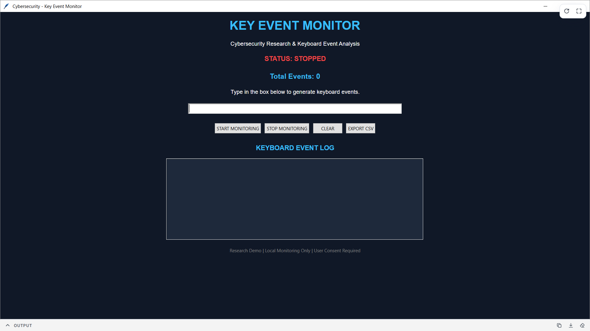
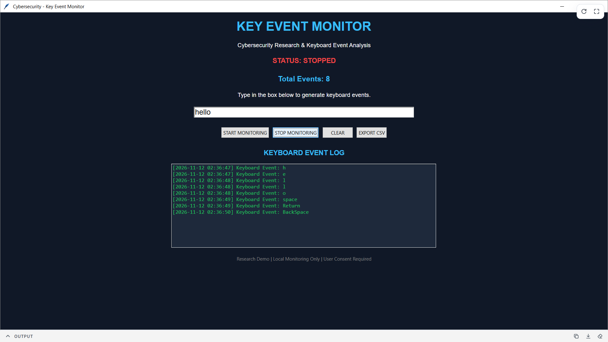

COMPANY: CODTECH IT SOLUTIONS
NAME: AISHNEEK DUTTA
INTERN ID: CITS8786
DOMAIN: CYBER SECURITY & ETHICAL HACKING
DURATION: 12 WEEKS
MENTOR: NEELA SANTHOSH KUMAR
DESCRIPTION: Task-3: Keylogger for Security Research

# Keylogger for Security Research – Safe Keyboard Event Monitor

## Project Overview

This project demonstrates keyboard event monitoring using Python as part of a Cybersecurity Internship.

The application captures keyboard event names inside a dedicated input field and displays them in a graphical dashboard.

It demonstrates the basic concepts of keyboard event handling, event logging, timestamps, and activity report generation.

## Features

- Real-time keyboard event monitoring.
- Graphical user interface using Tkinter.
- Start and Stop monitoring controls.
- Keyboard event counter.
- Timestamp-based event logging.
- CSV report generation.
- Clear event history functionality.
- Local monitoring with user consent.

## Technologies Used

- Python
- Tkinter
- CSV
- Datetime
- Visual Studio Code

## Project Structure

Keylogger-Security-Research/
│
├── keylogger.py
├── README.md
├── requirements.txt
├── screenshots/

## Installation

1. Install Python 3.
2. Clone this repository.
3. Open the project folder in VS Code.
4. Run the following command:

python keylogger.py

## How It Works

1. Launch the application.
2. Start keyboard monitoring.
3. Enter sample input in the dedicated text field.
4. View keyboard event names and timestamps.
5. Stop monitoring.
6. Export the event history as a CSV file.

## Security and Ethical Considerations

This project is designed exclusively for educational and cybersecurity research purposes.

- Monitoring is restricted to the application's own input field.
- No background keyboard monitoring is performed.
- No passwords or actual typed text are stored.
- No information is transmitted over a network.
- Users must provide consent before using the application.

## Screenshots

### Main Dashboard

### Keyboard Event Detection

## Learning Outcomes

- Understanding keyboard event handling.
- Learning event-based programming in Python.
- Understanding the basic concept of keylogging.
- Implementing timestamp-based logging.
- Generating CSV reports.
- Understanding privacy and ethical considerations in cybersecurity.